# Používateľská príručka – Dochádzka (terminál)

Stav k 14. 11. 2026. Príručka vysvetľuje, ako sa v termináli razí príchod a odchod, ako sa opravujú chýbajúce razenia a čo robí vedúci a správca. Obrázky sú z testovacej organizácie (zobrazujú sa len osobné čísla, žiadne mená) a ležia v [`docs/prirucka/`](prirucka/). Keď sa zmení vzhľad obrazovky, treba obnoviť aj príslušný obrázok.

Inštalácia terminálu ako aplikácie je v samostatnom manuáli (Word), tu je len stručne v poslednej kapitole.

## Čo aplikácia robí a kto s ňou pracuje

Terminál je webová aplikácia na razenie príchodov a odchodov. Otvára sa v prehliadači (Chrome, Edge) na počítači aj v telefóne, na adrese `https://offline-dochs.lovable.app`. Eviduje len osobné čísla, nie mená. Razenia sa do dochádzkového systému (Access) prenášajú súborom, ktorý vytvorí správca.

| Rola | Čo robí | Stránky v menu |
| --- | --- | --- |
| Zamestnanec | razí príchod, odchod a prerušenia, kontroluje svoj mesiac, žiada o opravu | Terminál, Môj mesiac |
| Vedúci | schvaľuje opravy a zariadenia svojho tímu, zapína automatické schvaľovanie opráv | + Môj tím |
| Správca | dáva prístup zamestnancom (PIN), sťahuje export pre Access, tlačí výkazy, nahráva nastavenia z Accessu | + Správa |

Menu v záhlaví sa prispôsobí vašej role: zamestnanec vidí dve položky, vedúci a správca viac. Každý, kto je vedúci alebo správca, môže robiť aj všetko, čo zamestnanec.

## Zamestnanec: prihlásenie a razenie

### Prvé prihlásenie

Od správcu dostanete kód organizácie (8 znakov), osobné číslo a PIN v tvare XXXX-XXXX-XXXX. PIN platí 24 hodín.

1. Otvorte aplikáciu a kliknite na *Otvoriť terminál*, potom na *Mám PIN od správcu*.
2. Vyplňte kód organizácie, osobné číslo a PIN.
3. Dvakrát zadajte nové heslo (aspoň 12 znakov).
4. Kliknite na *Nastaviť heslo a prihlásiť*.

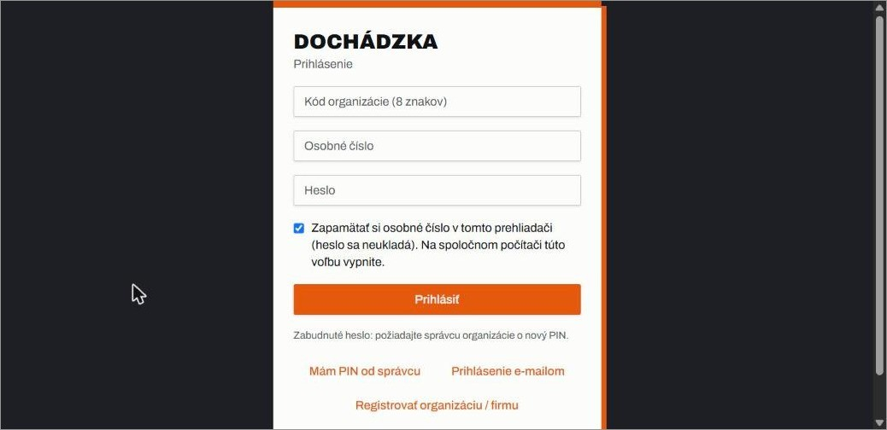

*Obrázok 1 – Prihlásenie (hotový účet)*

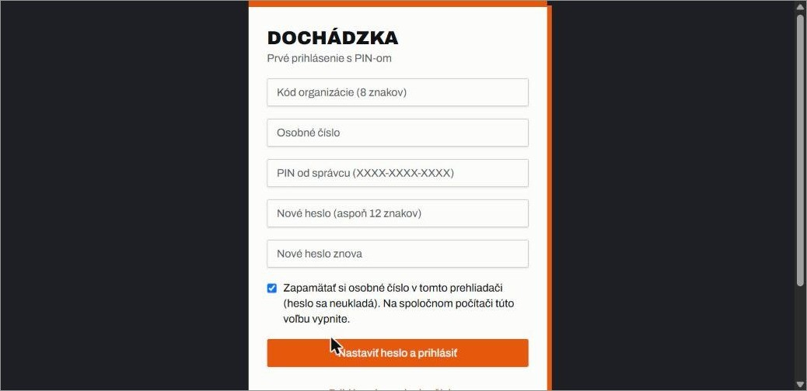

*Obrázok 2 – Prvé prihlásenie s PIN-om*

### Ďalšie prihlásenia

Zadáte kód organizácie, osobné číslo a heslo. Voľba *Zapamätať si osobné číslo* uloží len číslo, heslo nie; na spoločnom počítači ju vypnite. Ak heslo zabudnete, požiadajte správcu o nový PIN. Po dlhšej nečinnosti (predvolene 12 hodín) vás aplikácia odhlási; razenia, ktoré ešte neodišli, ostanú v zariadení a odošlú sa po ďalšom prihlásení.

### Razenie príchodu a odchodu

Na stránke *Terminál* vidíte hodiny, svoje osobné číslo, stav (*Dnes bez záznamu*, *Na pracovisku*) a vpravo zoznam *Dnešné záznamy*. Zelený pás *ONLINE* hore ukazuje spojenie so serverom; bez siete sa razenie uloží v zariadení a odošle sa po obnovení spojenia.

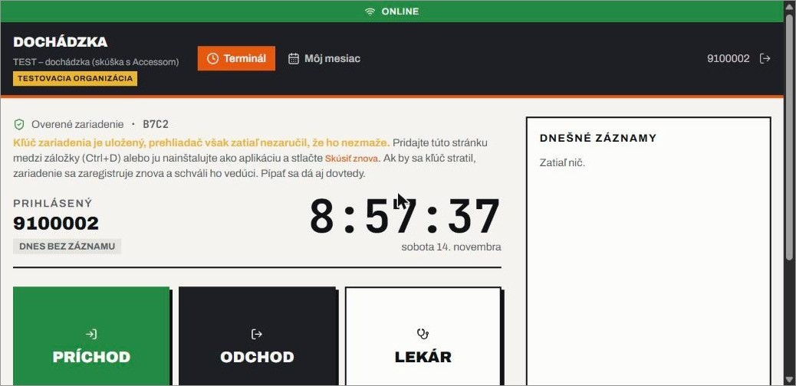

*Obrázok 3 – Terminál pred razením*

1. Pri príchode do práce kliknite na zelené tlačidlo *PRÍCHOD*.
2. Pri odchode kliknite na *ODCHOD*.
3. Ak odchádzate z iného dôvodu, zvoľte *LEKÁR*, *SPRIEVOD*, *SLUŽOBNÁ CESTA* alebo *SLUŽOBNÉ VZDIALENIE*. Po návrate razíte *PRÍCHOD*.
4. Skontrolujte, že sa záznam objavil v zozname *Dnešné záznamy* a stav sa zmenil.

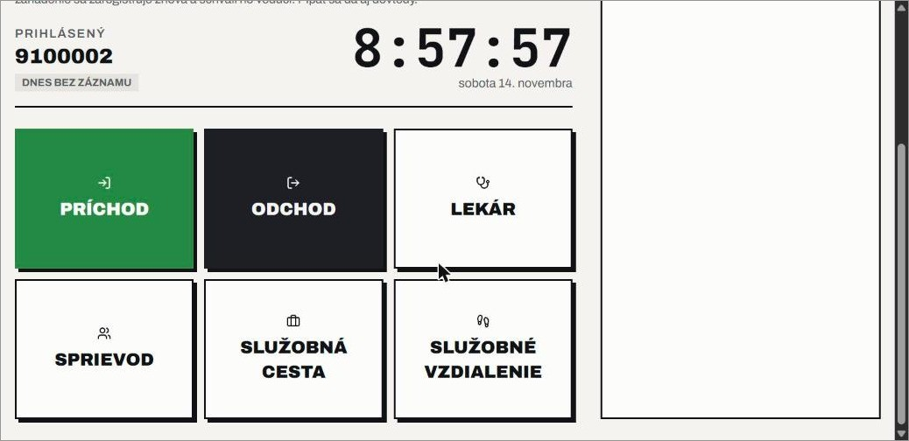

*Obrázok 4 – Tlačidlá terminálu*

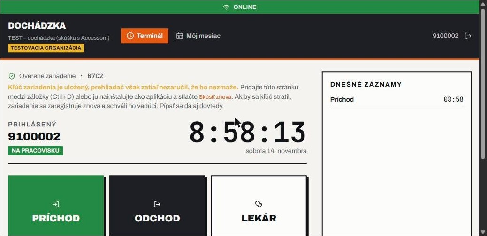

*Obrázok 5 – Po razení príchodu: záznam v zozname a stav Na pracovisku*

### Overené zariadenie

Každé zariadenie má vlastný kľúč, ktorý potvrdzuje, že razíte vy. Pri prvom použití na novom zariadení uvidíte *Zariadenie čaká na schválenie*: povedzte vedúcemu alebo správcovi šesticiferný kód (platí 10 minút) a štvorznakové označenie zariadenia. Kým ich neschváli, môžete raziť, záznamy sa však označia ako neoverené. Tlačidlo *Skontrolovať stav* zistí, či už zariadenie schválili. Po vymazaní údajov prehliadača alebo na novom zariadení použijete *Nahraď pôvodné zariadenie*; nové zariadenie opäť schváli vedúci.

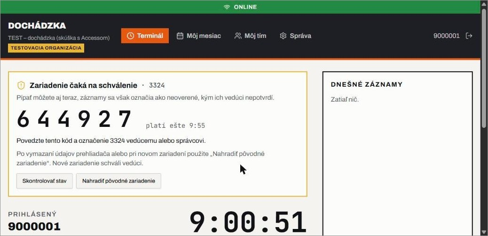

*Obrázok 6 – Zariadenie čaká na schválenie*

Aby kľúč zariadenia nezmizol, nepoužívajte anonymné okno a nemažte údaje stránky. Ak aplikácia hlási, že prehliadač nezaručil uchovanie kľúča, pridajte stránku medzi záložky (Ctrl+D) alebo ju nainštalujte ako aplikáciu (pozri poslednú kapitolu).

## Zamestnanec: Môj mesiac a žiadosť o opravu

### Prehľad mesiaca

Stránka *Môj mesiac* ukazuje všetky dni mesiaca. Medzi mesiacmi sa presúvate šípkami vedľa názvu mesiaca.

| Stĺpec | Význam |
| --- | --- |
| Deň | dátum; sviatky a víkendy sú vyznačené |
| Záznamy | vaše razenia v časovom poradí, s tlačidlom *zneplatniť* |
| Práca | odpracovaný čas |
| Dopočet | čas, ktorý sa podľa pravidiel pripočíta k práci (napr. návšteva lekára) |
| Spolu | práca + dopočet |
| Saldo | rozdiel oproti dennému fondu (červené = mínus) |

Riadok *Spolu (fond …)* dole sumárne zhŕňa mesiac. Červený štítok *chýba odchod* upozorňuje, že deň nemá uzatvorený odchod. Oranžové *K* pri zázname značí, že vzniklo opravou.

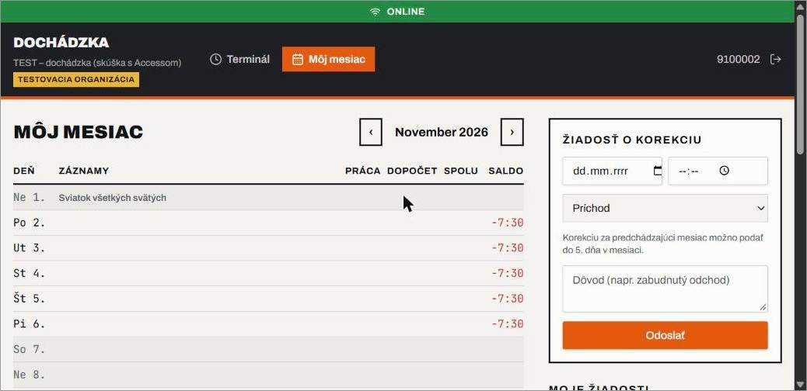

*Obrázok 7 – Môj mesiac*

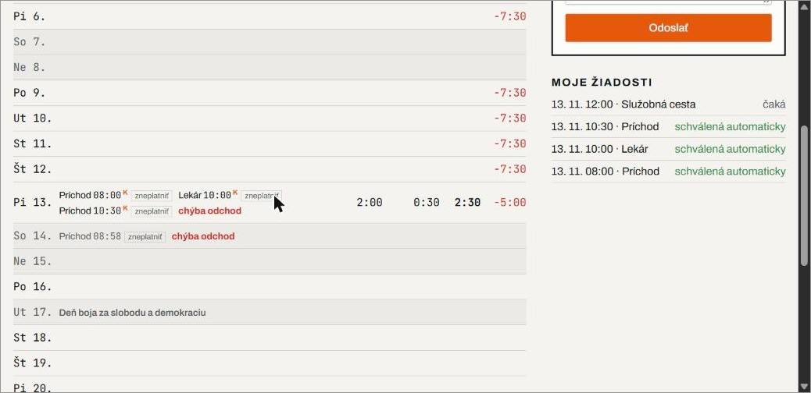

*Obrázok 8 – Záznamy za deň: razenia, opravy (K), chýbajúci odchod a zoznam žiadostí*

### Žiadosť o korekciu

Ak ste zabudli raziť alebo ste razili chybne, pošlite žiadosť o opravu.

1. V paneli *Žiadosť o korekciu* vpravo vyberte dátum a čas.
2. Zvoľte typ: *Príchod*, *Odchod* alebo prerušenie (napr. *Lekár*).
3. Napíšte dôvod (aspoň 3 znaky), napr. zabudnutý odchod.
4. Kliknite na *Odoslať*.

Korekciu za predchádzajúci mesiac možno podať do 5. dňa v mesiaci. V uzavretom mesiaci žiadosť nevznikne. Pod formulárom aplikácia píše, čo sa stalo, a v zozname *Moje žiadosti* vidíte stav každej žiadosti: *čaká* (rozhodne vedúci) alebo *schválená automaticky*.

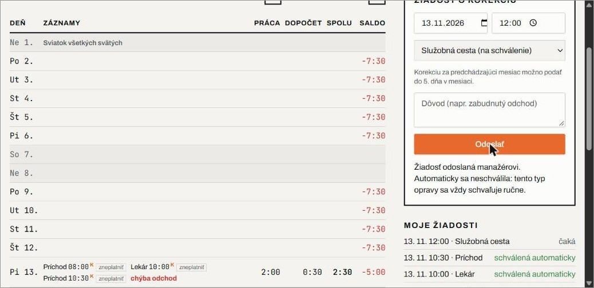

*Obrázok 9 – Žiadosť o korekciu a správa po odoslaní*

### Automatické schválenie opravy

Ak váš vedúci zapol automatické schvaľovanie, oprava sa schváli hneď a razenie sa započíta bez jeho rozhodnutia. Platí to, len keď sú splnené všetky podmienky:

- žiadosť ste poslali z overeného zariadenia (pozri vyššie),
- ide o príchod, odchod alebo prerušenie, ktoré nevyžaduje schválenie (typ posudzuje nastavenie platné pre mesiac opravy),
- čas nie je starší ako 14 dní a nie je v budúcnosti (5 minút tolerancie),
- opravy za daný deň sú najviac 5,
- oprava zapadá do poradia príchodov a odchodov dňa a rovnaká žiadosť ešte neexistuje.

Ak niektorá podmienka chýba, žiadosť sa neschváli sama, ale ostáva čakať na vedúceho a aplikácia píše prečo. Napríklad prerušenie, ktoré vyžaduje schválenie (v ukážke *Služobná cesta*), hlási: *tento typ opravy sa vždy schvaľuje ručne*.

### Zneplatnenie razenia

Ak ste razili omylom, kliknite pri zázname na *zneplatniť*. Tým pošlete vedúcemu žiadosť o zneplatnenie. Zneplatnené razenie ostáva v zázname (nemaže sa), ale nepočíta sa do dochádzky.

## Vedúci: Môj tím

Stránka *Môj tím* zhromažďuje všetko, čo vedúci rozhoduje. Hore je výber mesiaca a pod ním sú sekcie v tomto poradí.

### Korekcie na schválenie

Každá čakajúca žiadosť ukazuje osobné číslo, typ, dátum, čas a dôvod zamestnanca. Tlačidlom *Schváliť* vznikne razenie, ktoré sa započíta do dochádzky; *Zamietnuť* ju odmietne. Žiadosť, ktorú aplikácia nemohla schváliť automaticky, čaká tu.

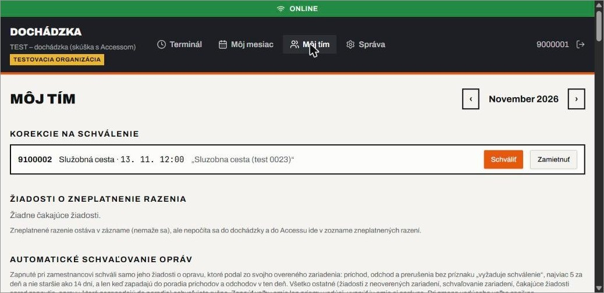

*Obrázok 10 – Korekcie na schválenie*

### Žiadosti o zneplatnenie razenia

Tu vidíte žiadosti zamestnancov o zneplatnenie razenia. Zneplatnené razenie ostáva v zázname (nemaže sa), ale nepočíta sa do dochádzky a do Accessu ide v samostatnom zozname zneplatnených razení.

### Automatické schvaľovanie opráv

Voľbu možno zapnúť pri každom priamom podriadenom. Zapnúť ju smie len priamy vedúci, vypnúť aj správca; pri zmene vedúceho voľba zanikne a nový vedúci ju musí zapnúť sám.

1. Pri zamestnancovi kliknite na *Zapnúť*.
2. Prečítajte upozornenie: opravy z jeho overeného zariadenia sa schvália okamžite, razenie sa započíta do dochádzky aj do mzdového exportu a zodpovednosť ostáva na vás.
3. Začiarknite *Rozumiem, že opravy zamestnanca … sa budú schvaľovať automaticky a že za ne zodpovedám ako vedúci*.
4. Potvrďte tlačidlom *Zapnúť automatické schvaľovanie*. Tlačidlo *Zrušiť* nezapne nič.

Samo sa schvaľujú len príchody, odchody a prerušenia bez príznaku *vyžaduje schválenie*, najviac 5 za deň a nie staršie ako 14 dní, len zo zariadenia, ktoré je overené. Žiadosti, ktoré čakali v čase zapnutia, ostávajú ručné. Neoverené zariadenia a schvaľovanie zariadení ostávajú vždy ručné. Vypnúť voľbu môžete kedykoľvek tlačidlom *Vypnúť*; vypnutie nepotrebuje súhlas.

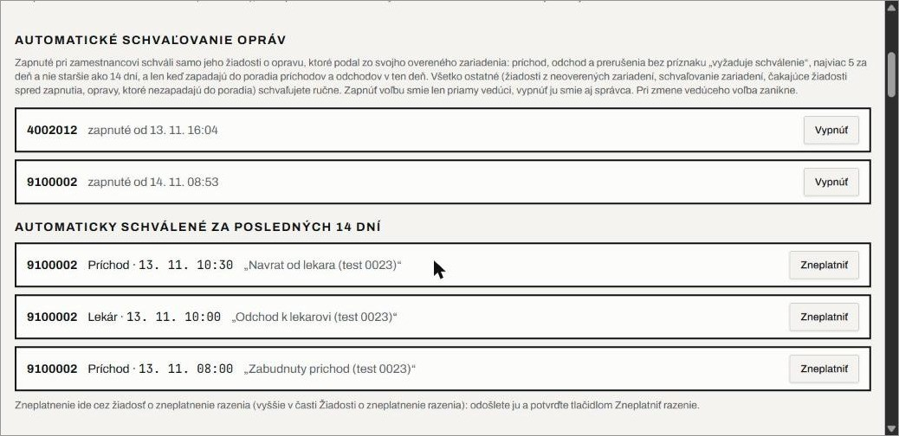

*Obrázok 11 – Automatické schvaľovanie a zoznam automaticky schválených opráv*

V sekcii *Automaticky schválené za posledných 14 dní* vidíte, čo sa schválilo bez vás. Ak je oprava chybná, kliknite na *Zneplatniť* (otvorí sa žiadosť o zneplatnenie razenia vyššie, ktorú potvrdíte tlačidlom Zneplatniť razenie).

### Zariadenia zamestnancov

Keď zamestnanec použije nové zariadenie, povie vám šesticiferný kód a štvorznakové označenie.

1. V sekcii *Zariadenia zamestnancov* nájdite zariadenie (vyhľadávanie podľa párovacieho kódu, označenia alebo osobného čísla; voľba *iba čakajúce*).
2. Porovnajte kód a označenie s tým, čo hovorí zamestnanec. Prečiarknutý kód už vypršal.
3. Kliknite na *Schváliť ako primárne* (hlavné zariadenie), *Ako záložné* (druhé zariadenie) alebo *Zrušiť*.

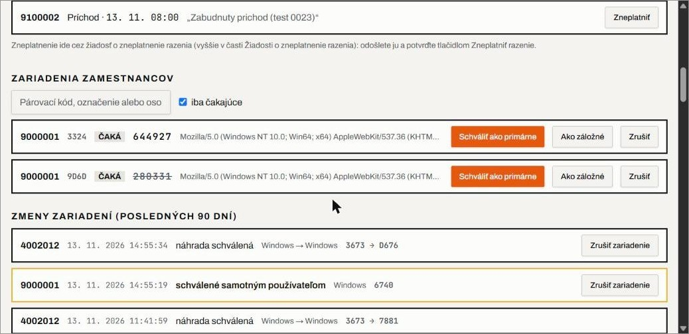

*Obrázok 12 – Čakajúce zariadenia a zmeny zariadení za 90 dní*

V zozname *Zmeny zariadení (posledných 90 dní)* vidíte schválenia a náhrady. Žlto orámované položky potvrdil len samotný používateľ (napr. zariadenie obnovené záchranným kódom): overte ich u zamestnanca a pri pochybnosti kliknite na *Zrušiť zariadenie* (napríklad pri strate telefónu).

### Pípnutia z neoverených zariadení

Razenia z neoverených zariadení ostávajú neoverené, kým ich ručne nepotvrdíte. Pred potvrdením si overte u zamestnanca, že razil on. Žiadne takéto razenie sa nepotvrdzuje automaticky.

### Prehľad mesiaca

Hore vidíte *Teraz v práci* (počet prítomných z celého tímu). Tabuľka má stĺpce *Zamestnanec*, *Teraz*, *Spolu*, *Saldo*, *Chýba odchod*, *Offline odchýlky* a *Neoverené*. Pri každom zamestnancovi sú tlačidlá *Výkaz A4* (výkaz na tlač) a *Uzavrieť* (uzavretie mesiaca zamestnancovi; potom už nemožno robiť opravy). Prehľad sa obnovuje každú minútu, kým s aplikáciou pracujete; po 10 minútach bez pohybu myšou alebo klávesu sa obnovovanie pozastaví.

## Správca: stránka Správa

Správa má dve záložky. *Prevádzka* obsahuje činnosti, ktoré správca robieva bežne. *Servis a testovanie* je určené na nastavenia, ktoré menia výpočet, a na testovanie; aplikácia tam upozorňuje: ak neviete, na čo slúžia, nič tu nemeňte.

### Prístup zamestnancov (osobné čísla a PIN)

Tu zamestnancom otvoríte prístup. Výsledok je kód organizácie a odkaz na prihlásenie, ktorý pošlete zamestnancom.

1. Vložte osobné čísla (každé na nový riadok) alebo nahrajte CSV z Accessu. Stačia čísla, mená nie sú potrebné.
2. Skontrolujte *Platných čísel* a kliknite na *Vydať PIN*.
3. PIN odovzdajte zamestnancovi osobne. PIN platí 24 hodín a slúži na prvé prihlásenie (zamestnanec si nastaví vlastné heslo).
4. Ak zamestnanec zabudol heslo, vydajte mu nový PIN. Voľbou *Obnoviť aj účty, ktoré už majú heslo* sa heslo zruší a zamestnanca odhlási zo zariadení; použite ju len pri hromadnom obnovení.

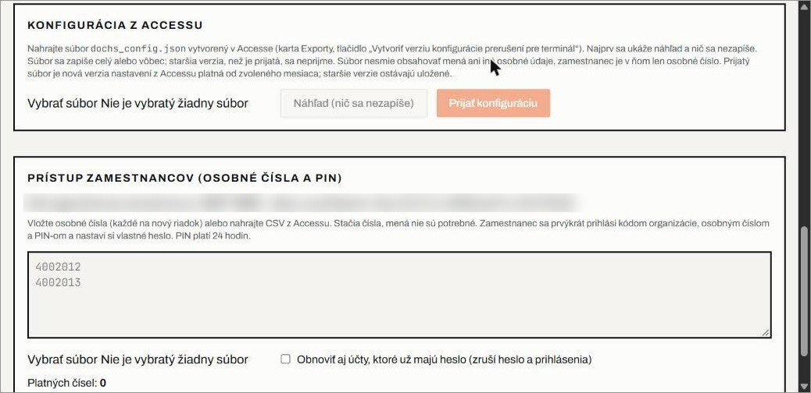

*Obrázok 13 – Konfigurácia z Accessu a prístup zamestnancov*

### Export pre dochádzkový systém (Access)

Zvoľte mesiac a kliknite na *Stiahnuť .csv*. Súbor obsahuje len osobné čísla a časy razení, žiadne mená. Voľba *Iba prírastok od ID* exportuje len nové razenia, teda všetky s vyšším ID, duplicity Access vyradí sám. Zneplatnené razenia ostávajú v súbore razení (kvôli reťazi hashov), preto ich Access dostane v samostatnom súbore tlačidlom *Zneplatnené razenia (.csv)*.

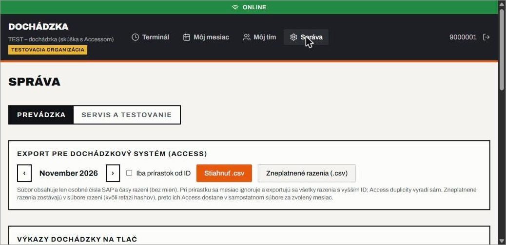

*Obrázok 14 – Export pre Access a Výkazy dochádzky na tlač*

### Výkazy dochádzky na tlač

Pre tých, čo nepoužívajú Access. Zvoľte mesiac a kliknite na osobné číslo zamestnanca. Výkaz sa otvorí na samostatnej stránke a vytlačíte ho tlačidlom *Tlačiť*. Obsahuje osobné číslo, razenia, salda za mesiac a miesto na podpisy; meno a priezvisko doplňte ručne.

### Konfigurácia z Accessu

Nastavenia z Accessu (prerušenia, pravidlá) nahráte súbor `dochs_config.json`, ktorý vytvorí Access na karte *Exporty* tlačidlom *Vytvoriť verziu konfigurácie prerušení pre terminál*.

1. Kliknite na *Vybrať súbor* a zvoľte `dochs_config.json`.
2. Kliknite na *Náhľad (nič sa nezapíše)* a skontrolujte, čo súbor obsahuje.
3. Ak je všetko v poriadku, kliknite na *Prijať konfiguráciu*. Súbor sa zapíše celý, alebo vôbec; staršia verzia, než je prijatá, sa neprijme.

Súbor nesmie obsahovať mená ani iné osobné údaje. Prijatý súbor je nová verzia nastavení platná od zvoleného mesiaca; staršie verzie ostávajú uložené.

### Servis a testovanie: pravidlá výpočtu a verzie nastavení

Každý mesiac patrí buď terminálu, alebo Accessu, podľa toho, odkiaľ pochádza nastavenie platné pre ten mesiac. Pri mesiaci, ktorý patrí terminálu, môže správca upraviť pravidlá výpočtu (zaokrúhlenie príchodu nahor a odchodu nadol, odpočet prestávky, predvolený denný fond) a sviatky. Úpravou vznikne nová verzia platná od zvoleného mesiaca (pole *Platí od*); staršie verzie ostávajú uložené a mesiac, ktorý má zamestnanec uzavretý, sa nemení. Zoznam *Verzie nastavení* ukazuje každú verziu, jej pôvod (Access alebo terminál), dátum a od ktorého mesiaca platí; pri aktuálnej je napísané *platí teraz*. Podrobnosti sú v [`VERZIE-NASTAVENI.md`](VERZIE-NASTAVENI.md).

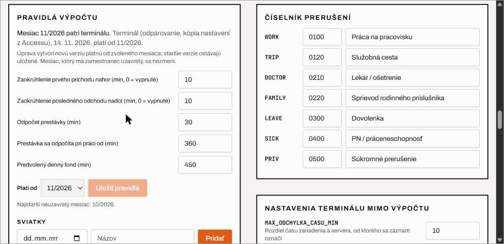

*Obrázok 15 – Pravidlá výpočtu a číselník prerušení*

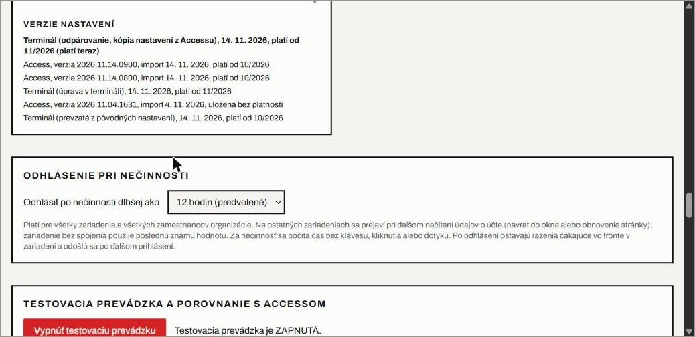

*Obrázok 16 – Verzie nastavení a odhlásenie pri nečinnosti*

V záložke *Servis a testovanie* nastavíte aj *Odhlásenie pri nečinnosti* (predvolene 12 hodín). Platí pre všetky zariadenia a všetkých zamestnancov organizácie. Sekcie *Testovacia prevádzka a porovnanie s Accessom*, *Export pre SAP (len na skúšku)* a *Prenos organizácie na iný server* používajte iba pri testovaní alebo pri presune organizácie a len podľa pokynov správcu systému.

## Inštalácia ako aplikácia a časté otázky

### Inštalácia

Terminál sa dá nainštalovať ako aplikácia (Chrome, Edge), vtedy sa spustí z ikony a lepšie uchová kľúč zariadenia. Otvorte `https://offline-dochs.lovable.app` v bežnom okne (nie v anonymnom), počkajte na načítanie a kliknite na ikonu inštalácie v adresnom riadku. Podrobný postup je v samostatnom Word súbore *Manuál inštalácie terminálu ako aplikácie*. Ak firemná politika inštaláciu blokuje, pridajte stránku medzi záložky (Ctrl+D).

### Časté otázky

| Situácia | Čo robiť |
| --- | --- |
| Zabudol(a) som heslo | Požiadajte správcu o nový PIN a pri prvom prihlásení si nastavte nové heslo. |
| Zabudol(a) som raziť príchod alebo odchod | V Môj mesiac pošlite žiadosť o korekciu. Ak vedúci zapol automatické schvaľovanie, schváli sa hneď; inak čaká na vedúceho. |
| Razil(a) som omylom | V Môj mesiac kliknite pri zázname na *zneplatniť*. Rozhodne vedúci. |
| Pri dni vidím červené *chýba odchod* | Deň nemá uzavretý odchod. Pošlite žiadosť o korekciu typu *Odchod*. |
| Terminál hlási *Zariadenie čaká na schválenie* | Povedzte vedúcemu šesticiferný kód a štvorznakové označenie zariadenia, potom kliknite na *Skontrolovať stav*. |
| Vymazal(a) som údaje prehliadača alebo mám nový telefón | Použite *Nahraď pôvodné zariadenie* a nechajte nové zariadenie schváliť vedúcim. |
| Moja žiadosť sa neschválila sama | Aplikácia pod formulárom píše dôvod (typ vyžaduje schválenie, zariadenie nie je overené, čas je starší ako 14 dní alebo v budúcnosti, dosiahnutý denný limit 5, oprava nezapadá do poradia razení). Žiadosť ostáva čakať na vedúceho. |
| Chcem opraviť predchádzajúci mesiac | Korekciu za predchádzajúci mesiac možno podať do 5. dňa v mesiaci. |
| Stratím telefón | Vedúci alebo správca ho zruší tlačidlom *Zrušiť zariadenie* v Môj tím. |

Ak si neviete rady, obráťte sa na svojho vedúceho alebo správcu dochádzky.
