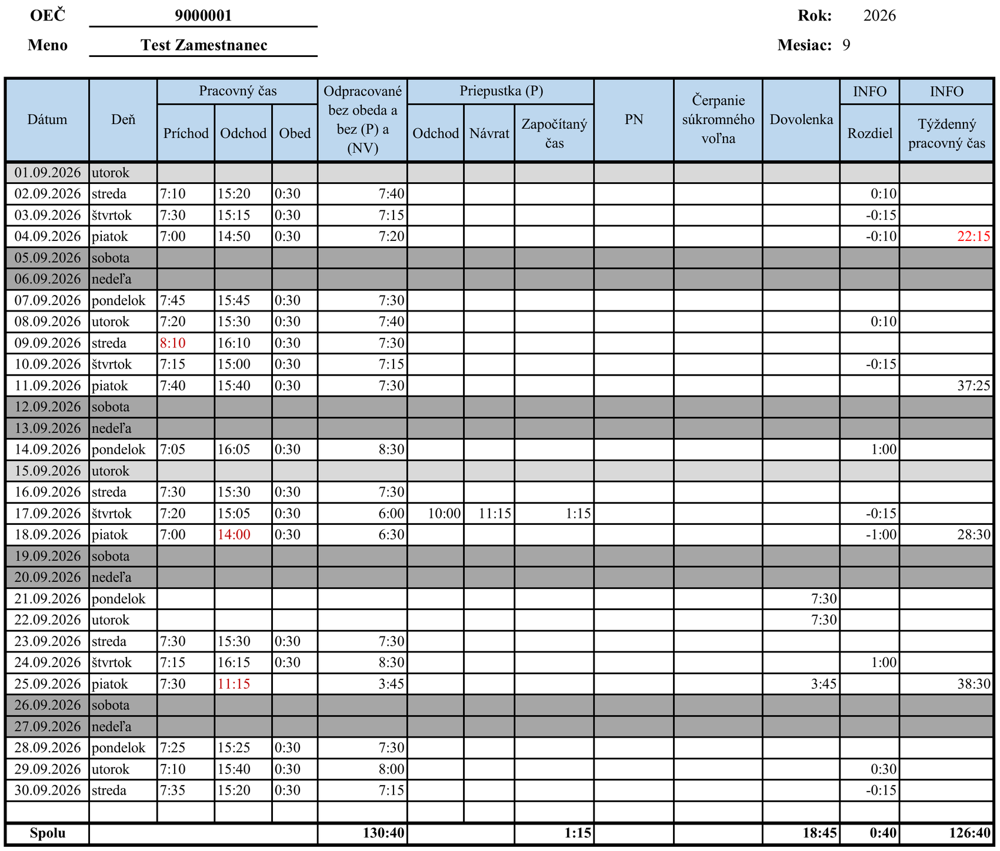

# Excel na saldo popri dochádzkovom zošite (testovacia verzia)

Stav: popis a testovacia kópia • dátum: 17. 11. 2026

Tento priečinok obsahuje **očistenú testovaciu kópiu** mesačného výkazu dochádzky v Exceli, popis, ako sa používa, a zoznam jeho obmedzení. Je to jedna z možností v prezentácii pre vedenie („dochádzkový zošit s Excelom“); je to podklad na rozhodnutie, nie odporúčanie. Excel nie je súčasť terminála ani Accessu a nič z neho sa do nich nenačíta.

| Súbor | Čo je |
|---|---|
| [`Dochadzka_2026_TEST.xlsx`](Dochadzka_2026_TEST.xlsx) | testovacia kópia: vymyslený zamestnanec `9000001`, údaje len v septembri 2026, **bez makier, bez metadát** |
| [`vykaz-september-2026.png`](vykaz-september-2026.png) | výkaz za september 2026 z tej istej kópie (tlač z Excelu) |

Názov súboru nemeň na iný bez `_2026_`: rok sa číta z názvu (pozri obmedzenia).



## 1. Čo to je

Zošit pre **jedného zamestnanca a jeden rok**: dvanásť mesačných hárkov (január až december) a dva skryté hárky (`sviatky`, `velka noc`). Zamestnanec (alebo určená osoba) do neho ručne prepíše časy zo zošita dochádzky. Excel z nich spočíta rozdiel za deň, týždenný súčet a **saldo mesiaca** (rozdiel medzi započítanými hodinami a pracovným fondom). Vedúci si môže hotový súbor pozrieť, ak ho dostane.

Používa sa popri dochádzkovom zošite: zápis a podpis ostávajú v zošite, Excel slúži len na zistenie salda a na náhľad.

## 2. Pôvod a úpravy

Šablónu pôvodne vytvoril kolega (meno nie je v súbore ani v tomto popise). Pri používaní bola doplnená:

* **kontrola ručného zápisu**: v stĺpci `R` sa ukáže značka **M**, ak zapísaný čas nie je aktuálny čas zaokrúhlený na 5 minút v deň zápisu (pôvodná verzia dovolila zapísať akýkoľvek čas bez upozornenia);
* **správny výpočet Veľkej noci** (Veľký piatok a Veľkonočný pondelok sa berú z tabuľky pre roky 2000 až 2041).

Táto kópia **nie je pracovný súbor**. Má nové údaje (vymyslené), nemá makrá a nemá metadáta pôvodného súboru (autor, posledný upravovateľ, firma, cesty, e-maily, SharePoint identifikátor, medzipamäť cesty z funkcie `CELL("filename")`). Výsledok sa skontroloval vyhľadaním reťazcov v XML súboru. Pôvodný pracovný súbor sa do repozitára nedáva.

## 3. Ako sa používa

1. Súbor pomenuj `Dochadzka_<rok>_<čokoľvek>.xlsx` (napr. `Dochadzka_2026_Novak.xlsx`). Rok sa číta z názvu za prvým podčiarkovníkom.
2. V hárku **január** vyplň `OEČ` (bunka `B1`) a `Meno` (`B2`); ostatné mesiace ich preberajú.
3. V mesačnom hárku zapisuj časy v tvare `H:MM`:
   * `C` Príchod, `D` Odchod;
   * `E` Obed sa doplní sám na 0:30 (nie cez víkend, sviatok, dovolenku ani v prázdny deň);
   * `G` a `H` Priepustka: odchod a návrat;
   * `M` PN (7:30 = celý deň, alebo napr. 2:00 návšteva lekára namiesto priepustky);
   * `N` Čerpanie súkromného voľna;
   * `O` Dovolenka (7:30 celý deň, 3:45 pol dňa).
4. Čítaj výsledok:
   * `F` odpracované bez obeda a bez priepustky, `L` započítaný čas priepustky;
   * `P` rozdiel za deň oproti 7:30, `Q` týždenný súčet (v piatok);
   * päta: `F41` Spolu, `F43` započítané hodiny (odpracované + priepustka + dovolenka), `F46` pracovný fond (pracovné dni × 7:30), **`F47` rozdiel fondu a odpracovaných hodín (saldo)**.
5. Farby: sobota a nedeľa, sviatok a dnešný deň majú vlastnú farbu (legenda je v stĺpci `AA`). Príchod po 8:00 a odchod pred 14:30 sa ukáže červeno. V stĺpci `R` je značka **M** pri ručne zapísanom čase (na obrazovke, nie v tlači).
6. Tlačová oblasť je `A1:Q54`.

## 4. Pravidlá výpočtu (ako sú vo vzorcoch)

| Pravidlo | Hodnota |
|---|---|
| denná norma | 7:30 (bunka `F5`) |
| obed | 0:30 automaticky |
| priepustka | započíta sa čas mimo pracoviska do 14:30 (v júli a auguste do 13:00); viac než 7:29 mimo pracoviska sa berie ako celý deň 7:30 |
| červený príchod / odchod | po 8:00 / pred 14:30 (limity v skrytom hárku `sviatky`, bunky `P7`, `Q7`) |
| týždenný súčet (`Q`) | odpracované (`F`) + dovolenka (`O`) za týždeň, zapíše sa v piatok; zvýraznenie pod 37:30 pozri obmedzenie 7 |
| pracovný fond | pracovné dni mesiaca (bez víkendov a sviatkov zo zoznamu) × 7:30 |
| saldo (`F47`) | započítané hodiny + PN + súkromné voľno − fond |

## 5. Ukážka v súbore

September 2026, vymyslené údaje: 18 dní s príchodom a odchodom, jedna priepustka (17. 9., 10:00 až 11:15), dovolenka celý deň 21. a 22. 9., pol dňa 25. 9. (príchod 7:30, odchod 11:15, dovolenka 3:45).

| Veličina | Hodnota |
|---|---|
| odpracované (`F41`) | 130:40 |
| priepustky (`L`) | 1:15 |
| dovolenka (`O`) | 18:45 |
| započítané hodiny (`F43`) | 150:40 |
| pracovný fond (`F46`) | 150:00 (20 dní) |
| **saldo (`F47`)** | **+0:40** |
| týždenné súčty (`Q`) | 22:15, 37:25, 28:30, 38:30 |

Overenie: výsledok sa nezávisle prepočítal v Pythone, súbor sa prepočítal v LibreOffice a vytlačil sa v skutočnom Exceli (obrázok vyššie). Tabuľka Veľkej noci (roky 2000 až 2041, 42 riadkov) sa porovnala s nezávislým výpočtom: 0 rozdielov.

**Pozor na sviatky v ukážke.** Zoznam sviatkov v zošite berie 1. 9. a 15. 9. ako sviatky (pracovný fond septembra je preto o dva dni kratší). Podľa zákona č. 241/1993 Z. z. (informatívne znenie od 29. 10. 2026, [slov-lex](https://static.slov-lex.sk/static/SK/ZZ/1993/241/20261029.html)) 1. 9. nie je dňom pracovného pokoja a v roku 2026 podľa § 4b nie sú dňami pracovného pokoja ani 8. 5. a 15. 9. Čísla v ukážke preto platia pre Excel tak, ako je, nie pre zákon: pri 22 pracovných dňoch by fond bol 165:00.

## 6. Obmedzenia

1. **Ručný prepis.** Excel nenačíta údaje z papiera, Accessu ani terminála. Chybný prepis dá chybný výsledok; značka M len upozorní, že čas nie je aktuálny čas, nepotvrdzuje správnosť.
2. **Jeden súbor = jeden zamestnanec a jeden rok.** Nie je prehľad tímu, nie sú zostavy a nie je import ani export do HR Accessu alebo terminála.
3. **Pravidlá sú vo vzorcoch a skrytých hárkoch** (norma 7:30, obed 0:30, limity 8:00 a 14:30, sviatky). Zmena pravidla sa musí urobiť v každom súbore zvlášť.
4. **Zoznam sviatkov je pevný** (hárok `sviatky`, dátumy sa skladajú s rokom). Veľká noc sa počíta, ostatné dátumy nie. Pri zmene zákona (pozri vyššie) alebo pri sviatku, ktorý nie je dňom pracovného pokoja, treba zoznam upraviť ručne a skontrolovať každý rok.
5. **Rok sa berie z názvu súboru** (za prvým `_`). Ak v názve nie je rok, použije sa rok z hodín počítača a v januári sa výkaz prepočíta na nový rok. Funkcia `CELL("filename")` potrebuje uložený súbor.
6. **Priepustka v lete.** Horná hranica (bunka `K5`) sa v júli a auguste prepína na 13:00. Dolná hranica (`J5`) odkazuje na `O2` (text „Mesiac:“) namiesto `P2` (číslo mesiaca), takže letná dolná hranica 8:00 sa nepoužije. Týka sa len júla a augusta, nebolo to overované s údajmi.
7. **Týždenné zvýraznenie** pod 37:30 je len v prvom týždni mesiaca (bunky `Q10:Q14`).
8. **Dátumový systém 1904**, presnosť podľa zobrazenia a iteratívny výpočet sú v zošite zapnuté. Pri kopírovaní dátumov do iného zošita sa dátumy posunú o 1 462 dní a hodnoty sa zaokrúhlia na zobrazené.
9. **Verzia Excelu.** Zošit používa funkciu `SHEETS()` (Excel 2013 a novší). V LibreOffice niektoré pomocné bunky skrytých hárkov ukážu chybu `#HODNOTA!`, výpočet dňa a salda to neovplyvnilo.
10. **Zdieľanie.** Vedúci vidí saldo len vtedy, keď dostane súbor. Pracovný súbor obsahuje meno a osobné číslo, preto sa s ním zaobchádza ako s ostatnými osobnými údajmi (táto testovacia kópia ich neobsahuje).
11. **Makrá nie sú v tejto kópii** (pozri nižšie), preto sa vyplnené bunky samy nezamykajú.

## 7. Ako doplniť makro (zamykanie vyplnených buniek)

V pôvodnom súbore bolo jedno krátke makro, rovnaké v mesačných hároch (v júli chýbalo): po každej zmene hárka odomkne hárok, zamkne každú **neprázdnu** bunku v oblasti `A10:Q40` a hárok znova zamkne heslom. Vyplnený čas sa tak už nedá prepísať bez hesla.

Heslo z pôvodného súboru sa sem **nekopíruje**; zvoľ vlastné a ulož ho mimo zošita.

1. Súbor ulož ako **Zošit programu Excel s podporou makier (`*.xlsm`)** (Súbor, Uložiť ako); názov nechaj v tvare `Dochadzka_2026_...`.
2. V hárku január vyplň `OEČ` a `Meno` (`B1`, `B2` sú zamknuté, po zamknutí hárka by sa už nedali zapísať).
3. Stlač `Alt+F11`. V okne Project dvakrát klikni na **ThisWorkbook** a vlož kód nižšie (jedno miesto pre všetky mesiace, vlastné heslo namiesto `ZVOL-SI-VLASTNE`):

```vba
Private Sub Workbook_SheetChange(ByVal Sh As Object, ByVal Target As Range)
    Const HESLO As String = "ZVOL-SI-VLASTNE"
    Dim bunka As Range

    Select Case Sh.Name
        Case "sviatky", "velka noc": Exit Sub
    End Select

    Sh.Unprotect Password:=HESLO
    For Each bunka In Sh.Range("A10:Q40").Cells
        If Not IsError(bunka.Value) Then
            If bunka.Value <> "" Then bunka.Locked = True
        End If
    Next bunka
    Sh.Protect Password:=HESLO
End Sub
```

4. Každý mesačný hárok jednorazovo zamkni tým istým heslom (Revízia, Zamknúť hárok). Vstupné bunky (`C`, `D`, `G`, `H`, `M`, `N`, `O`) sú v súbore už odomknuté, vzorce zamknuté.
5. Skúška: zapíš príchod do niektorého dňa. Bunka sa zamkne; úprava vyžaduje Revízia, Odomknúť hárok a heslo.
6. Pri otvorení treba kliknúť **Povoliť obsah**, inak makro nebeží. Súbory `.xlsm` môže pošta alebo sieť blokovať a makrá musí dovoliť pravidlo pracoviska.

Tento kód je napísaný nanovo podľa popisu (nie je kópiou pôvodného) a nebol spustený v skutočnom Exceli; otestuj ho na kópii.

## 8. Čo je overené a čo nie

Overené: september 2026 (výpočet tromi spôsobmi), Veľká noc 2000 až 2041, vyčistenie metadát, vstupné bunky odomknuté a vzorce zamknuté.

Neoverené: makro (len prečítaný kód, nespúšťal sa), ostatné mesiace s údajmi, júl a august, iné verzie Excelu, zoznam sviatkov voči zákonu pre iné roky než 2026.
